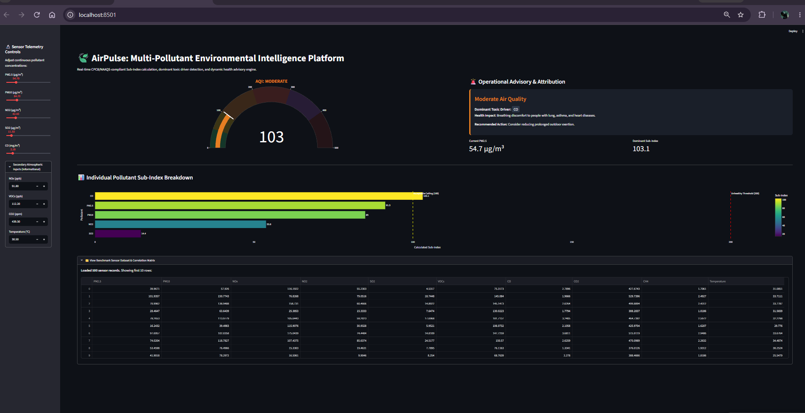
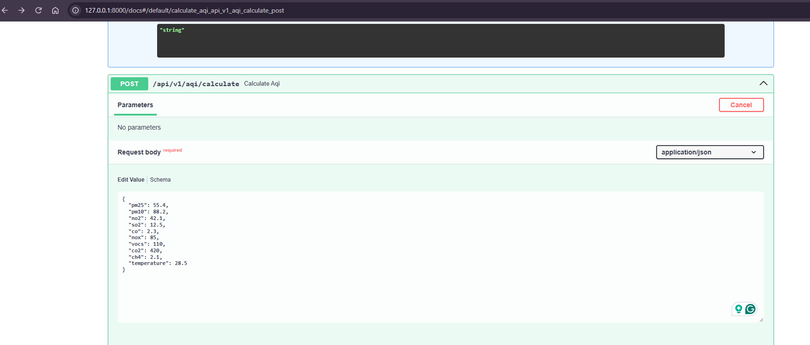
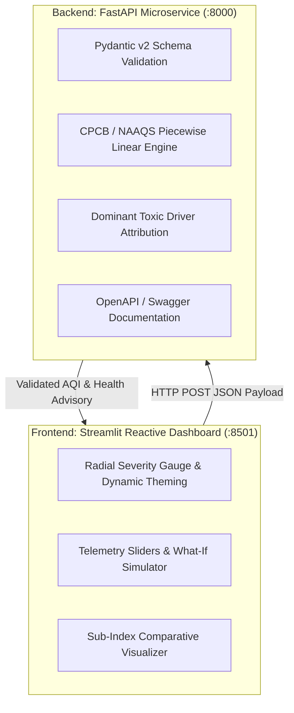

# AirPulse: Multi-Pollutant Environmental Intelligence Platform


An end-to-end environmental intelligence microservice and reactive decision-support platform built with **FastAPI** and **Streamlit**. The system ingests multi-pollutant sensor telemetry, executes official CPCB / NAAQS piecewise linear interpolation algorithms to calculate Air Quality Index (AQI) sub-indices, attributes dominant toxic drivers, and serves dynamic health advisories via a validated REST API.

---

## Platform Interface & Live REST API

### Reactive Streamlit Dashboard (`:8501`)


### Interactive Swagger API Documentation (`:8000/docs`)


---

## Architecture Overview



---

## Mathematical Formulation

### 1. Piecewise Linear Sub-Index Interpolation (CPCB / NAAQS)
For any given pollutant concentration $C_p$, the sub-index $I_p$ is calculated using linear interpolation across official standard breakpoint intervals:

$$I_p = \left[ \frac{I_{\text{hi}} - I_{\text{lo}}}{B_{\text{hi}} - B_{\text{lo}}} \right] (C_p - B_{\text{lo}}) + I_{\text{lo}}$$

Where:
* $C_p$: Measured concentration of pollutant $p$.
* $B_{\text{hi}}, B_{\text{lo}}$: Breakpoint concentration bracket containing $C_p$.
* $I_{\text{hi}}, I_{\text{lo}}$: Sub-index values corresponding to $B_{\text{hi}}$ and $B_{\text{lo}}$.

### 2. Overall AQI & Dominant Toxic Driver Attribution
The overall Air Quality Index represents the maximum sub-index across all monitored chemical agents:

$$\text{AQI} = \max \{ I_{\text{PM2.5}}, I_{\text{PM10}}, I_{\text{NO}_2}, I_{\text{SO}_2}, I_{\text{CO}} \}$$

$$\text{Dominant Pollutant} = \arg\max_{p} \{ I_p \}$$

---

## National Ambient Air Quality Standards (CPCB Breakpoints)

| Category | AQI Range | PM2.5 ($\mu\text{g/m}^3$) | PM10 ($\mu\text{g/m}^3$) | $\text{NO}_2$ ($\mu\text{g/m}^3$) | $\text{SO}_2$ ($\mu\text{g/m}^3$) | CO ($\text{mg/m}^3$) |
| :--- | :---: | :---: | :---: | :---: | :---: | :---: |
| **Good** | 0 – 50 | 0 – 30 | 0 – 50 | 0 – 40 | 0 – 40 | 0 – 1.0 |
| **Satisfactory** | 51 – 100 | 31 – 60 | 51 – 100 | 41 – 80 | 41 – 80 | 1.1 – 2.0 |
| **Moderate** | 101 – 200 | 61 – 90 | 101 – 250 | 81 – 180 | 81 – 380 | 2.1 – 10.0 |
| **Poor** | 201 – 300 | 91 – 120 | 251 – 350 | 181 – 280 | 381 – 800 | 10.1 – 17.0 |
| **Very Poor** | 301 – 400 | 121 – 250 | 351 – 430 | 281 – 400 | 801 – 1600 | 17.1 – 34.0 |
| **Severe** | 401 – 500 | 250+ | 430+ | 400+ | 1600+ | 34.0+ |

---

## API Specification

### Endpoint: Compute AQI
* **Route:** `POST /api/v1/aqi/calculate`
* **Request Payload:**
```json
{
  "pm25": 54.7,
  "pm10": 84.7,
  "no2": 42.4,
  "so2": 11.5,
  "co": 2.18,
  "nox": 91.8,
  "vocs": 112.2,
  "co2": 439.3,
  "temperature": 30.5
}
```

* **Response Payload (HTTP 200 OK):**
```json
{
  "overall_aqi": 103.1,
  "category": "Moderate",
  "dominant_pollutant": "CO",
  "sub_indices": {
    "PM2.5": 91.2,
    "PM10": 84.7,
    "NO2": 53.0,
    "SO2": 14.4,
    "CO": 103.1
  },
  "color_hex": "#e67e22",
  "health_advisory": "Breathing discomfort to people with lung, asthma, and heart diseases.",
  "actionable_guidance": "Consider reducing prolonged outdoor exertion."
}
```

---

## Repository Structure

| File / Directory | Purpose |
| :--- | :--- |
| `air_quality_dataset.csv` | Multi-pollutant sensor telemetry dataset |
| `api.py` | FastAPI REST microservice & Pydantic validation schemas |
| `app.py` | Streamlit reactive UI with Plotly visual components |
| `dashboard_preview.png` | UI screenshot: Real-time gauge & sub-index breakdown |
| `swagger_docs_preview.png` | API screenshot: OpenAPI `/docs` test harness |
| `requirements.txt` | Project dependencies |
| `README.md` | Architecture, mathematical formulations & documentation |

---

## Setup & Local Execution

### 1. Clone the Repository
```powershell
git clone [https://github.com/AshutoshTembhekar/air-quality-intelligence-engine.git](https://github.com/AshutoshTembhekar/air-quality-intelligence-engine.git)
cd air-quality-intelligence-engine
```

### 2. Install Dependencies
```powershell
py -3.12 -m pip install -r requirements.txt
```

### 3. Launch FastAPI Microservice
```powershell
py -3.12 -m uvicorn api:app --reload --port 8000
```
* Interactive Swagger API documentation: `http://127.0.0.1:8000/docs`
* Raw JSON schema: `http://127.0.0.1:8000/openapi.json`

### 4. Launch Streamlit UI Dashboard
In a separate terminal instance:
```powershell
py -3.12 -m streamlit run app.py
```
* Access the interactive dashboard: `http://localhost:8501`
---

## Author

**Ashutosh Tembhekar**  
*Data & Analytics Professional*  
[](https://github.com/AshutoshTembhekar)
[](https://github.com/AshutoshTembhekar?tab=repositories)
